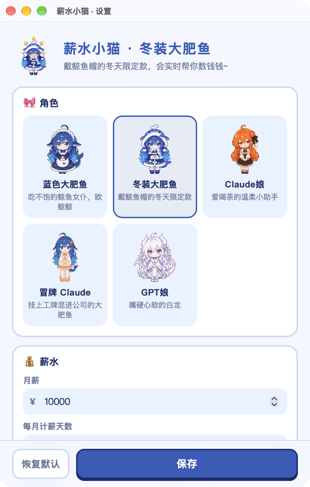

# SalaryKitten（薪水小猫）

<p align="center">
  
</p>

<p align="center">
  デスクトップで 1 秒ごとにお給料を数えてくれる、ちびキャラのデスクトップマスコット
</p>

<p align="center">
  <a href="https://salarykitten.pages.dev/ja/">ウェブサイト</a> · <a href="https://github.com/dollarkillerx/SalaryKitten/releases/latest">ダウンロード</a>
</p>

<p align="center">
  <a href="./README.md">English</a> | <a href="./README.zh-CN.md">简体中文</a> | <strong>日本語</strong>
</p>


## 機能

- **リアルタイム給料カウンター** - 「月給 ÷ 月の給与日数 ÷ 1 日の実労働秒数」で 0.1 秒ごとに加算。昼休みは加算せず、退勤後は停止
- **出退勤のお知らせ** - 出勤時に「おつかれさま」、退勤時に今日の稼ぎを報告。昼休み前・昼休み開始・昼休み終了もお知らせ
- **今日の目標** - 目標額（例：¥100）に届いたら旗と紙吹雪でお祝い
- **5 人のキャラクター** - 蓝色大肥鱼、冬服の大肥鱼、Claude娘、ニセ Claude、GPT娘。それぞれ 9 つのポーズ、専用のセリフと配色
- **本物のデスクトップマスコット** - どこへでもドラッグ（位置を記憶）、クリックでおしゃべり、金額をクリックで時給や退勤までの時間を表示。透明な部分のクリックはデスクトップに届きます
- **ボスモード** - ワンクリックですべての金額を隠します（吹き出し・通知・メニューバー）
- **メニューバー / トレイ** - macOS のメニューバーに今日の稼ぎを表示。Windows はトレイのツールチップ
- **自動アップデート** - 起動後に GitHub Releases をバックグラウンドで確認し、準備ができたらお知らせ。更新は署名で検証
- **軽量** - Tauri 2 製。macOS のインストーラーは 7 MB 未満
- **クロスプラットフォーム** - macOS（Apple シリコンと Intel）と Windows 10/11

## スクリーンショット

| | |
|---|---|
|  |  |
| お仕事中の蓝色大肥鱼 | 昼休みにお昼寝する GPT娘 |
|  |  |
| 詳細カード：時給、昼休みまでの時間、目標 | 設定：キャラクター、給料、勤務時間、昼休み、目標、アップデート |

## インストール

- **macOS**（Apple シリコンと Intel、macOS 12 以降）：`SalaryKitten-mac.dmg` をダウンロードし、SalaryKitten をアプリケーションフォルダへドラッグ。署名・公証済み。
- **Windows**（x64、Windows 10/11）：`SalaryKitten-win-Setup.exe` をダウンロード。まだコード署名していないため、SmartScreen が表示されたら **詳細情報 → 実行** を選んでください。

インストール後は自動でアップデートされます（マスコットを右クリック →「检查更新」、または 設定 →「更新」）。
※ アプリ内の表示は現在中国語です。

## 開発

Node 18 以上と Rust（`rustup`）が必要です。

```bash
npm install
npm run dev      # マスコットを起動
npm test         # 給料計算のテスト
```

## リリース

[docs/RELEASING.md](./docs/RELEASING.md) を参照してください。

## キャラクターについて

すべてのキャラクターはファンメイドのちびキャラです。蓝色大肥鱼はオープンライセンスのキャラクターです。Claude娘と GPT娘はファンによる擬人化で、
本プロジェクトは Anthropic、OpenAI、DeepSeek とは一切関係ありません。「Claude」「GPT」は各社の商標です。

## ライセンス

[MIT](./LICENSE)
