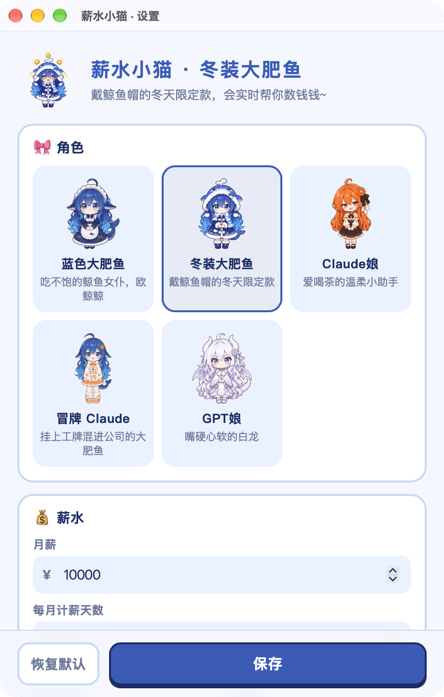

# SalaryKitten

<p align="center">
  
</p>

<p align="center">
  A chibi desktop pet that counts your salary in real time, second by second
</p>

<p align="center">
  <a href="https://salarykitten.pages.dev">Website</a> · <a href="https://github.com/dollarkillerx/SalaryKitten/releases/latest">Download</a>
</p>

<p align="center">
  <strong>English</strong> | <a href="./README.zh-CN.md">简体中文</a> | <a href="./README.ja-JP.md">日本語</a>
</p>


## Features

- **Live salary counter** - Monthly salary ÷ paid days per month ÷ working seconds per day, ticking every 0.1 s. Lunch breaks are unpaid, and the counter stops after work
- **Work-day reminders** - Greets you when work starts, sees you off at the end of the day with today's total, and reminds you before lunch, at lunch and when lunch is over
- **Daily goal** - Celebrates with a flag and confetti when you reach your goal (for example ¥100)
- **Five characters** - 蓝色大肥鱼, Winter 大肥鱼, Claude娘, "Fake Claude" and GPT娘, each with 9 poses, her own lines and her own colours
- **A real desktop pet** - Drag it anywhere (the position is remembered), click her to chat, click the counter for hourly pay and time until the end of the day; clicks on empty space go through to the desktop
- **Boss mode** - Hide every amount (bubbles, notifications, menu bar) with one click
- **Menu bar / tray** - Today's earnings in the macOS menu bar; tray tooltip on Windows
- **Auto-update** - Checks GitHub Releases in the background after launch and tells you when an update is ready; updates are signed
- **Small** - Built with Tauri 2: about 4 MB on Windows and 11 MB on macOS (one app for Apple silicon and Intel)
- **Cross-platform** - macOS (Apple silicon and Intel) and Windows 10/11

## Screenshots

| | |
|---|---|
|  |  |
| 蓝色大肥鱼 at work | GPT娘 napping at lunch |
|  |  |
| Details card: hourly pay, time until lunch, goal | Settings: character, salary, hours, lunch, goal, updates |

## Install

- **macOS** (Apple silicon and Intel, macOS 12 or later): download `SalaryKitten-mac.dmg` and drag SalaryKitten to Applications. Signed and notarized.
- **Windows** (x64, Windows 10/11): download `SalaryKitten-win-Setup.exe`. Not code-signed yet: if SmartScreen appears, choose **More info → Run anyway**.

Installed apps update themselves (right-click the pet → 检查更新, or Settings → 更新).

## Development

Requires Node 18+ and Rust (`rustup`).

```bash
npm install
npm run dev      # start the pet
npm test         # salary engine tests
```

Debug URL parameters for the pet window (set `url` in `src-tauri/tauri.conf.json`):
`pet.html?now=2026-11-18T11:54:50&speed=20` simulates the clock, `&details` opens the details card,
`&character=gpt` switches character without saving, `&settings` opens the settings window.

## Release

See [docs/RELEASING.md](./docs/RELEASING.md): `scripts/release-macos.sh <version>` builds the signed, notarized macOS
installer and updater archive; GitHub Actions builds the Windows installer; `scripts/publish-release.sh <version>`
writes `latest.json` and uploads everything to the GitHub release.

## Adding a character

1. Draw the 9 poses on a green screen into `design/green-screen/<id>/` (`design/brief-states.md` lists them; Codex can generate them from a brief like `design/brief-claude.md`).
2. `swift scripts/key-sprites.swift <id>` removes the background and writes 400×400 PNGs to `ui/assets/characters/<id>/` (compressed with `pngquant` if installed).
3. Add the character to `ui/shared/characters.js` (name, colours) and her lines to `ui/shared/lines.js`.

## Project layout

```
ui/                    Front end (plain HTML/CSS/JS, no build step)
  pet.*                Pet window
  settings.*           Settings window
  shared/salary.js     Salary engine (pure functions, unit-tested)
  shared/characters.js Character list
  shared/lines.js      Lines for each character
  assets/characters/   Sprites
src-tauri/             Tauri shell: tray, settings window, notifications, autostart, updater
website/               Website (Cloudflare Pages)
design/                Character briefs, references, Codex green-screen originals
scripts/               Sprite, screenshot and release scripts
```

## Characters

All characters are fan-made chibi art. 蓝色大肥鱼 is an openly licensed character. Claude娘 and GPT娘 are fan
personifications: SalaryKitten is not affiliated with Anthropic, OpenAI or DeepSeek, and "Claude" and "GPT" are
trademarks of their owners.

## License

[MIT](./LICENSE)
